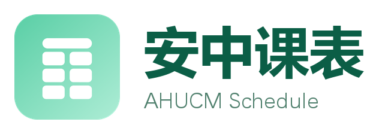
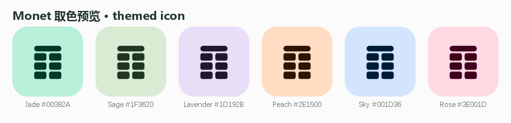
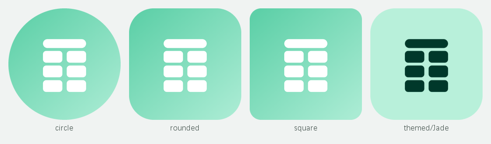
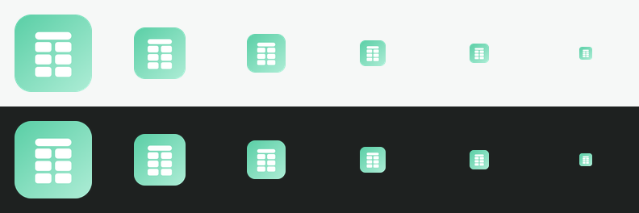

# 安中课表 · Logo 设计规范



课表就是这门应用的形状：标志由「一条学期标题栏 + 2×3 课程块」组成，落在薄荷玉色
的圆角方块上。没有文字也能认出是课程表，深浅色主题和 Monet 取色下都成立。

## 概念

| 元素 | 含义 |
| --- | --- |
| 圆角方块底 | 应用图标本体，半径 112/512（约 21.9%） |
| 顶部横条 | 学期 / 周次标题栏 |
| 6 个课程块 | 周一到周日 × 节次的课表网格，2 列 3 行 |
| 薄荷玉色渐变 | 中医药院校的草本气质，同时保持高亮度、低攻击性 |

标志刻意不含叶子、胶囊等具象元素：课表应用最需要的是「一眼看出是课表」，草本气质
交由配色表达，图形本身保持几何、可缩放、可单色化。

## 调色板

| 用途 | 色值 |
| --- | --- |
| 背景渐变起点（左上） | `#5ED0A8` |
| 背景渐变终点（右下） | `#A9EBD3` |
| 图形 | `#FFFFFF` |
| 深色文字 / 单色正形 | `#0B5E46` |
| 辅助文字 | `#4E7F6C` |

渐变方向约 135°，端点在设计网格 `(40,16) → (472,496)`。

## 几何规范（512 × 512 设计网格）

- 背景方块：`0,0,512,512`，圆角 `112`
- 标题栏：`136,116,240,50`，圆角 `25`（两端为半圆）
- 课程块：`108 × 66`，圆角 `18`
- 课程块位置：x = `136 / 268`，y = `182 / 264 / 346`
- 水平间距 `24`，垂直间距 `16`，四周留白 `136 / 116`

## Monet 取色

沿用同一套课表几何，启动图标按系统版本适配：

- Android 8–11：普通自适应图标保持薄荷玉色渐变与白色图形。
- Android 12+：普通自适应图标的渐变与图形通过 `values-v31` / `values-night-v31`
  引用系统 `system_accent1_*` / `system_neutral1_*` 调色板，跟随系统壁纸取色与深浅模式。
  浅色使用 accent1 100→200 与 neutral1 900，深色使用 accent1 800→700 与 neutral1 100。
- Android 13+：`mipmap-anydpi-v33` 额外声明 **monochrome 图层**，引用
  `drawable/ic_launcher_monochrome.xml`。它只提供透明背景上的白色图形遮罩；开启主题图标且
  启动器支持时，最终前景和背景颜色由启动器决定。`mipmap-anydpi-v26` 仅声明彩色前景与背景。
- 启动图标的配色跟随系统，与应用内手动选择的主题色独立；启动器可能缓存图标，实际刷新行为
  需要在对应设备上验证。Windows 的静态 `icon.ico` / `icon.png` 继续使用品牌色。
- 自适应图标前景为 `0.82` 缩放版本，保证图形落在 66dp 安全圈内，圆形 / 圆角方形
  启动器遮罩下都不会被裁切（见 `adaptive-preview.png`）。
- 应用内「暂无课表」空状态使用同一几何的 `BrandMark`，颜色直接取
  `MiuixTheme.colorScheme.primary / onPrimary`，因此 Android 与 Windows 的 Mon­et
  动态配色都会生效。

下图为单色主题图标的示意配色，不代表设备实际 Monet 调色板或普通彩色图标的实时截图。





## 小尺寸



最小可用尺寸 16 px。小于 32 px 时标题栏与网格会融合成整体色块，属预期表现；
不要在小尺寸下另画一版细节更多的图形。

## 文件清单

| 文件 | 用途 |
| --- | --- |
| `logo.svg` | 主标志（圆角方块，1024 画布） |
| `logo-512.png` / `png/logo-*.png` | 16–1024 px 位图导出 |
| `logo.ico` | Windows 多尺寸图标（16–256） |
| `logo-mark.svg` | 仅图形、透明背景，用于自定义底色场合 |
| `logo-monochrome.svg` / `.png` | 单色正形，供系统染色的场景 |
| `logo-adaptive-background.svg` | Android 自适应图标背景层 |
| `logo-adaptive-foreground.svg` | Android 自适应图标前景层（0.82 缩放） |
| `logo-lockup-light.png` | 横向组合标志（浅色底） |
| `logo-lockup-dark.png` | 横向组合标志（深色底） |
| `sizes-preview.png` / `adaptive-preview.png` / `monet-preview.png` | 设计检查图 |

已接入位置：

- Android：`androidApp/src/main/res/drawable/ic_launcher_*.xml`、
  `mipmap-anydpi-v26/ic_launcher*.xml`、`mipmap-anydpi-v33/ic_launcher*.xml`、
  `values*/ic_launcher_colors.xml`、`mipmap-*/ic_launcher*.png`
- Windows：`composeApp/src/desktopMain/resources/icon.ico`（安装包与 exe 图标）、
  `icon.png`（窗口图标）

## 重新生成

```powershell
powershell -NoProfile -ExecutionPolicy Bypass -File design\tools\build-logo.ps1
```

流程：`build_logo.py spec` 生成 SVG/矢量 XML 与无头浏览器页面 → `render.ps1` 用
Microsoft Edge 栅格化 → `build_logo.py export` 生成 PNG、ICO、Android mipmap、
组合标志与预览图。依赖 Windows 自带微软雅黑 / 等线字体，以及 DSH 内置 Python
（Pillow）。所有几何参数集中在 `design/tools/logo_spec.py`，改颜色或间距后重跑即可。
同一生成器也生成版本化配色资源及 adaptive / monochrome 声明，重新生成会保留 Monet 适配。

## 使用约束

- 保持等比缩放，不要拉伸、加描边、加投影或改变课程块间距。
- 标志四周至少保留图标宽度 1/8 的留白。
- 深色底用 `logo-lockup-dark.png`，浅色底用 `logo-lockup-light.png`。
- 需要单色印刷或系统染色时使用 `logo-monochrome.svg`，不要把彩色版去色。
- 主色只用于品牌与强调，不要替换应用内 Monet 主题色。
